# SimDash

Self-hosted lap times, telemetry and driving coach for sim racing.

A small collector on your gaming PC reads the game's shared memory and sends
every finished lap to a server in your home lab. Each lap includes its full
trace: time, speed, pedals, gear, steering and position every ~5 m. The web UI
shows your personal bests, compares laps, coaches you corner by corner and
mirrors the car live on a second screen or your phone.

**What runs where**

| Part | Runs on | What it does |
|---|---|---|
| **Server + web UI** | Linux: a Debian/Ubuntu host, VM or **LXC container** (e.g. on Proxmox), Python 3.11+ | Stores laps (SQLite), runs the coach, serves the web UI on port **8080** |
| **Collector** | The Windows gaming PC (where the sim runs) | Small Python script that reads the game's shared memory and sends laps to the server |
| **Browser** | Any PC, tablet or phone on your LAN | Open `http://<server-ip>:8080` |

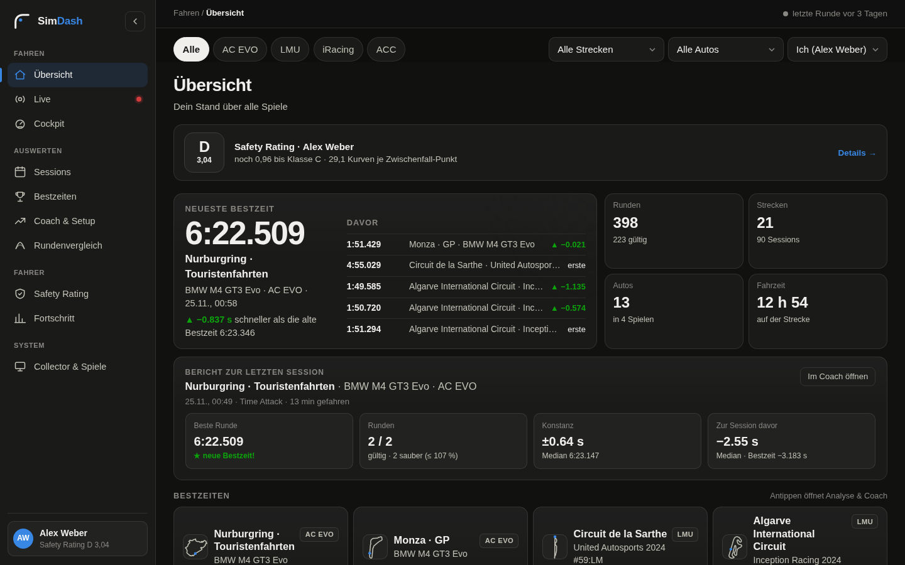

## Features

**Overview**
- Personal best per game / track / layout / car, PB history, key figures
- **Session report** for the latest session: best lap, consistency, change from
  the previous session, the corner with the most time to gain, and your latest
  setup note
- Sessions grouped and collapsible, with *PB*, *invalid*, *estimated*, *out lap*
  and *in lap* markers
- **Drivers**: assign laps or whole sessions to friends, map in-game names
  (nicknames, profile names) to a driver, set who is driving right now. Other
  drivers' laps don't count toward your bests and can be tracked separately
- **Safety rating** in the style of iRacing: corners per incident point over
  the last sessions, licence classes R–A, history per session

**Analysis & coach** ([how the coach works](docs/coach.md))
- Corners are detected automatically from the speed trace
- Your PB lap is compared with your **best own run through each corner** →
  ideal lap, time potential, top 3 corners with concrete tips (*"brake ~18 m
  later"*, *"carry 5 km/h more through the apex"*, *"full throttle 15 m
  earlier"*), split into entry and exit loss
- **Corner history**: corner time and braking point lap by lap, so you can see
  whether a tip is working
- **Progress**: best and median lap per session over time
- **Setup & notes** per track/car
- **Lap comparison**: track map coloured by speed difference (GPS-track style
  with callouts), delta over the lap, 10 mini sectors, speed overlay; every
  corner split into braking, turn-in, apex and exit
- **Driving technique**: brake, steering and throttle together per corner
  (trail braking, coasting, throttle pick-up, lifts)
- **Setup diagnosis**: understeer and oversteer per corner and phase from
  steering vs. driven line and countersteer, with the time it costs and setup
  suggestions; **setup logbook** with an automatic before/after comparison

**Live** (≈10 Hz over Server-Sent Events)
- Live delta to your PB, predicted lap time, sector deltas, track map with trail
- Speed, gear, rpm, pedals, steering, G-forces, last 20 s trace
- Tyres (pressure, core and surface temperatures), brakes, assists (TC, ABS, brake
  bias, engine map), engine and fuel range
- Fits one 1080p screen and works on a phone (screen stays awake)
- **Cockpit** for a phone at the rig: full-screen delta, times, speed/gear,
  sectors, fuel, and a **ghost coach** that shows a hint ~220 m before each
  corner where you have been faster; optional **voice callouts**

## Screenshots

All screenshots use demo driver names.

| Coach | Live |
|---|---|
| 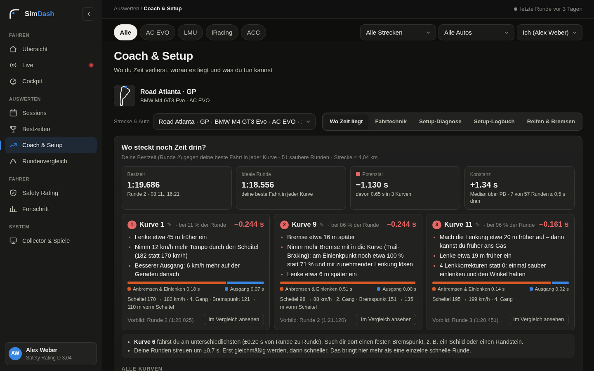 | 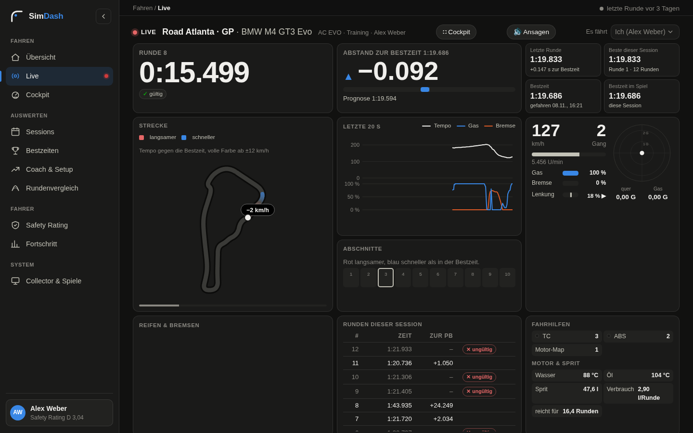 |
| **Driving technique** | **Setup diagnosis** |
| 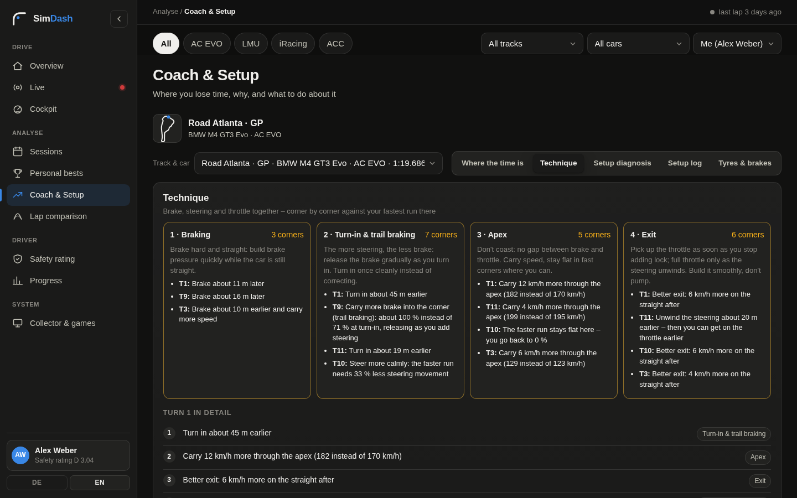 | 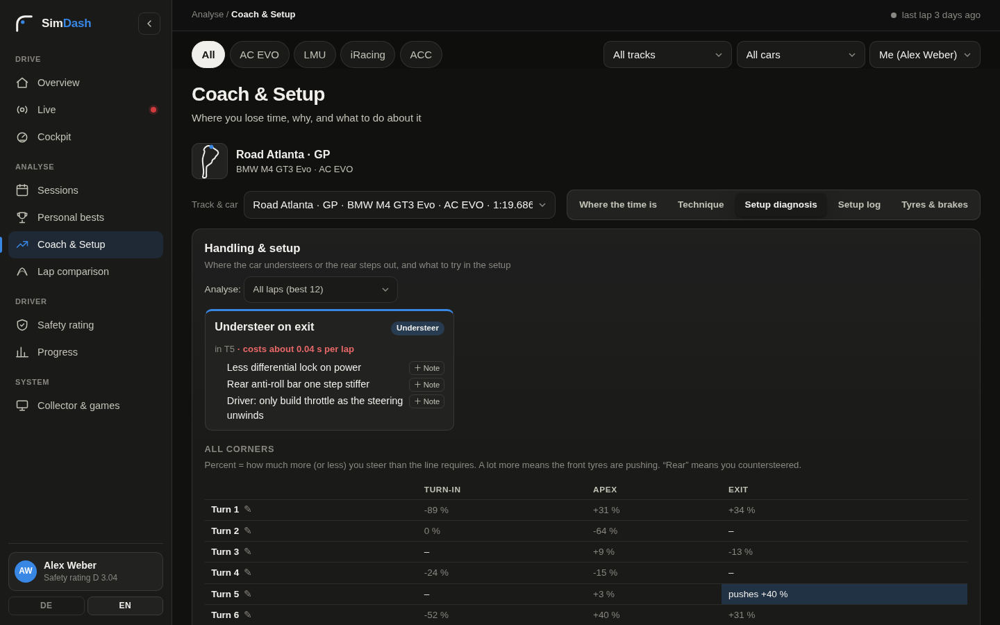 |
| **Lap comparison** | **Safety rating** |
| 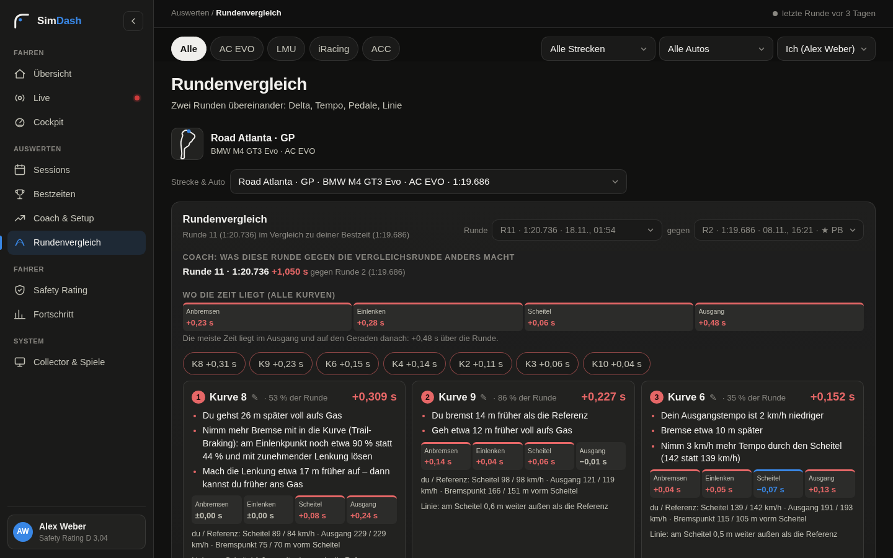 | 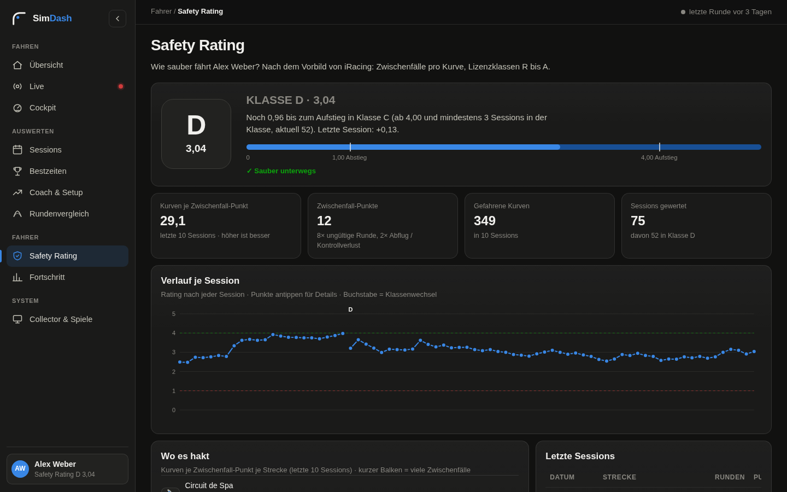 |
| **Progress** | **Sessions** |
| 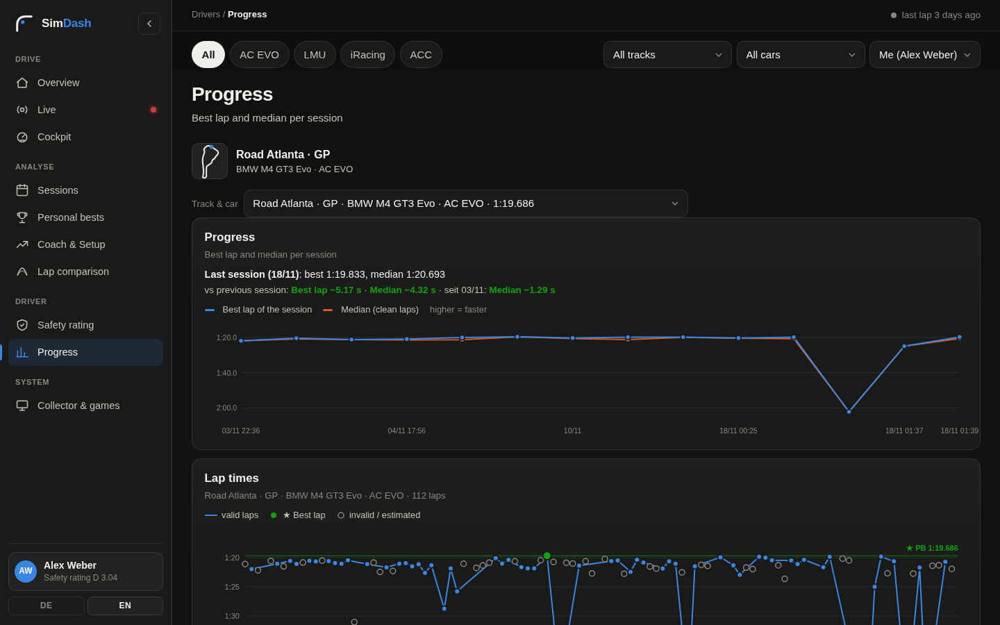 | 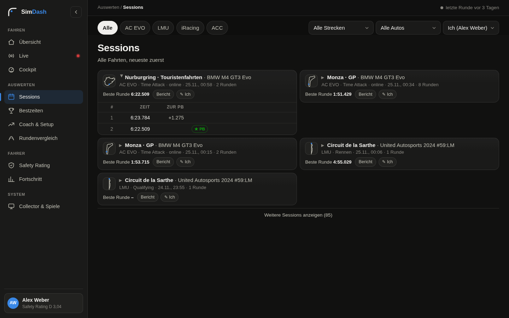 |

| Cockpit on a phone | Phone | Drivers |
|---|---|---|
| 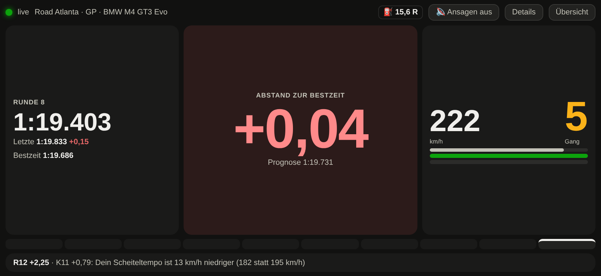 | 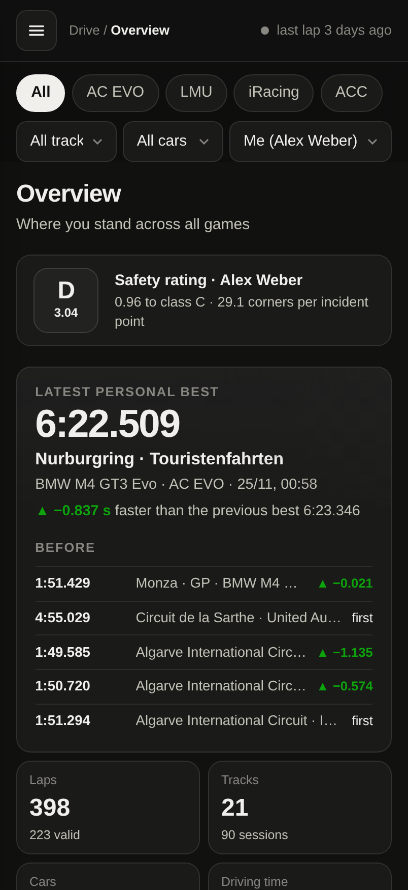 | 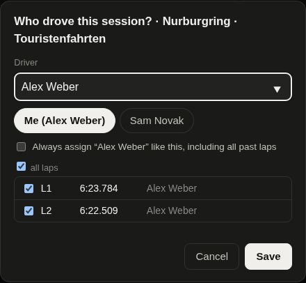 |

**Robust collection**
- Every lap is written locally first (`laps.csv` + queue) and resent when the
  server is back, so a dropped connection never loses a PB
- If the game never reports the lap (disconnect at the line), the time is taken
  from the running timer and marked *estimated*
- The collector uses only the Python standard library

## Supported games

| Game | Source | Lap validity | Trace / map | Live telemetry |
|---|---|---|---|---|
| Assetto Corsa EVO | `Local\acevo_pmf_*` | from game | ✓ / ✓ | full (tyres, brakes, assists, damage) |
| Assetto Corsa Competizione | `Local\acpmf_*` | from game | ✓ / ✓ | full |
| Assetto Corsa (2014) | `Local\acpmf_*` | not reported | ✓ / ✓ | physics block |
| Assetto Corsa Rally | `Local\acpmf_*` (ACC layout) | unknown | ✓ / ✓ | experimental |
| iRacing | iRacing SDK memory map | derived (4 wheels off / incident = invalid) | ✓ / – (no world position) | inputs, G, fuel, temperatures |
| Le Mans Ultimate | `LMU_Data` (official shared-memory interface) | from game | ✓ / ✓ | experimental |
| Automobilista 2 | `$pcars2$` (Project CARS 2 API, enable in *Options → System → Shared Memory*) | from game | ✓ / ✓ | inputs, G, yaw, fuel, tyres, brakes, TC/ABS |

AC EVO has been tested most in real driving. The others are implemented from
the official documentation and tested less.

## Quick start

```sh
# Server: any Debian/Ubuntu host or LXC with Python 3.11+ and root SSH
./deploy/deploy.sh root@<server-ip>
```

Then open `http://<server-ip>:8080` and download the collector from the link at
the bottom of the page. On the gaming PC:

1. Install Python 3.11+ (`winget install Python.Python.3.12`)
2. Unpack the download to `C:\SimDash`, put the token from the server's
   `/etc/simdash.env` into `simdash.ini`
3. Put a shortcut `pyw -3 C:\SimDash\simdash_collector.py` into `shell:startup`

Full instructions: **[docs/installation.md](docs/installation.md)**

## Documentation

| | |
|---|---|
| [Installation](docs/installation.md) | Server, collector, autostart, updates, troubleshooting |
| [User guide](docs/user-guide.md) | Overview, analysis, coach, live tab, drivers, notes |
| [Coach](docs/coach.md) | How corners, potential and tips are calculated |
| [Architecture](docs/architecture.md) | Data flow, collector internals, trace format, database |
| [API](docs/api.md) | HTTP endpoints |
| [Development](docs/development.md) | Local setup, tests, release |
| [Changelog](CHANGELOG.md) | Versions |

## Architecture in one picture

```
Gaming PC (Windows, desktop session)          Home lab (Linux / LXC)
┌──────────────────────────────┐              ┌─────────────────────────────────┐
│ simdash_collector.py (50 Hz) │  POST laps   │ FastAPI + SQLite  (:8080)       │
│  shared memory → lap detector├─────────────▶│  /api/laps, /api/coach, …       │
│  laps.csv + queue.jsonl      │  POST live   │  live state → SSE stream        │
│  live sender (10 Hz)         ├─────────────▶│  static web UI (vanilla JS/SVG) │
└──────────────────────────────┘              └───────────────┬─────────────────┘
                                                              │ browser / phone
```

## Security

Reading is open on the LAN. The collector writes with a bearer token
(`SIMDASH_TOKEN`). Edits from the UI (drivers, notes) are accepted from private
and loopback addresses or with the token. SimDash is meant for a home network.
Don't expose it to the internet without a reverse proxy and authentication.

## Credits

- Struct layouts follow Kunos' official shared-memory documentation for AC EVO
  and ACC and the iRacing SDK.
- Offsets were cross-checked against the independent structs in
  [live-telemetry-evo](https://github.com/albertowd/live-telemetry-evo) (no code copied).

## License

[MIT](LICENSE)
