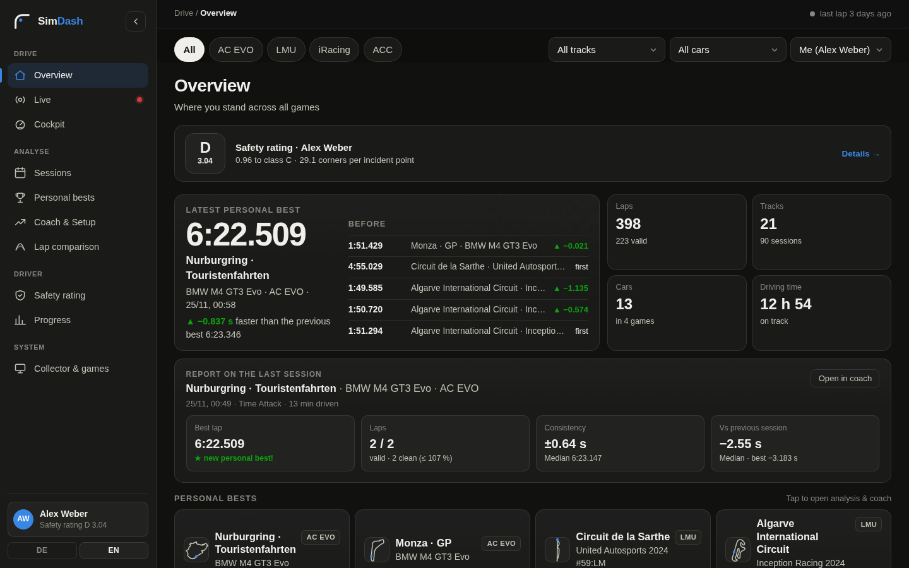
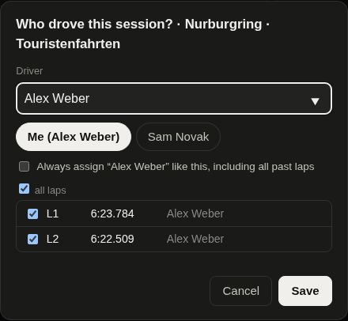
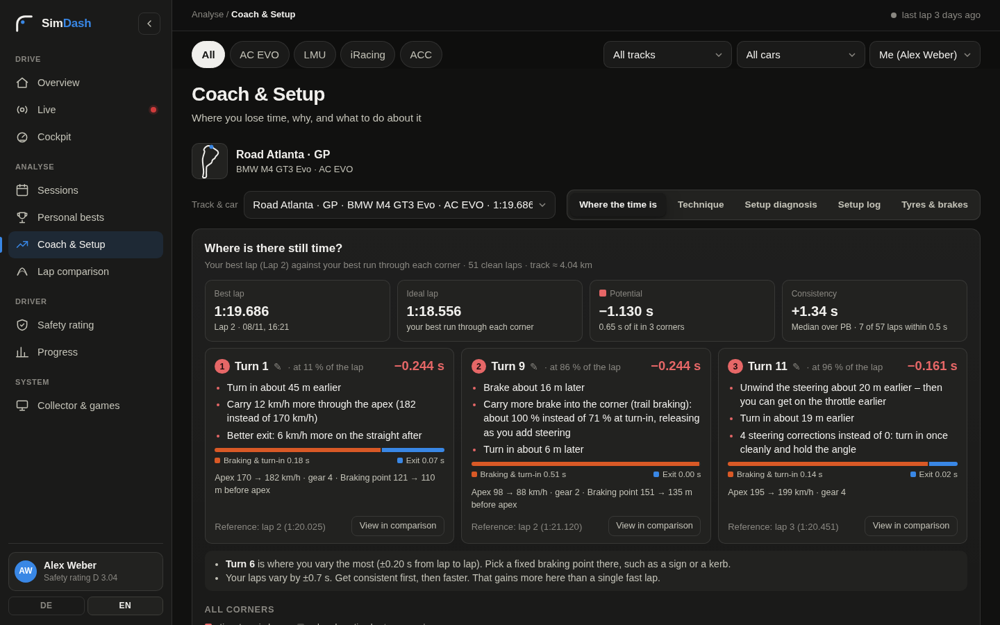
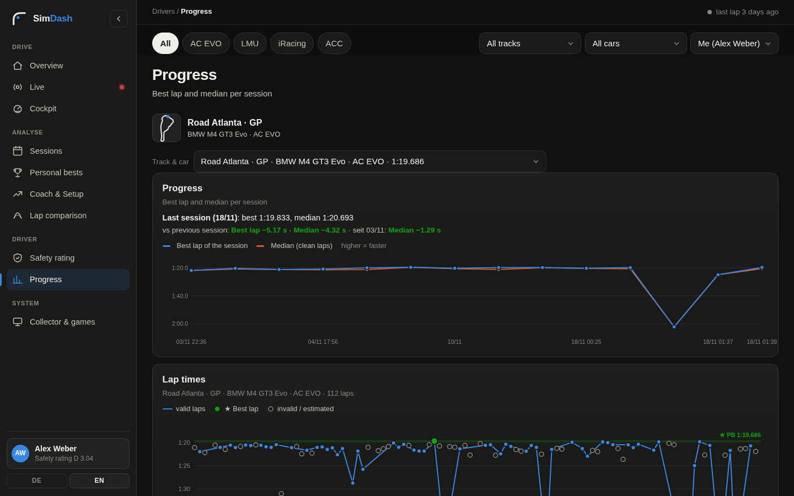
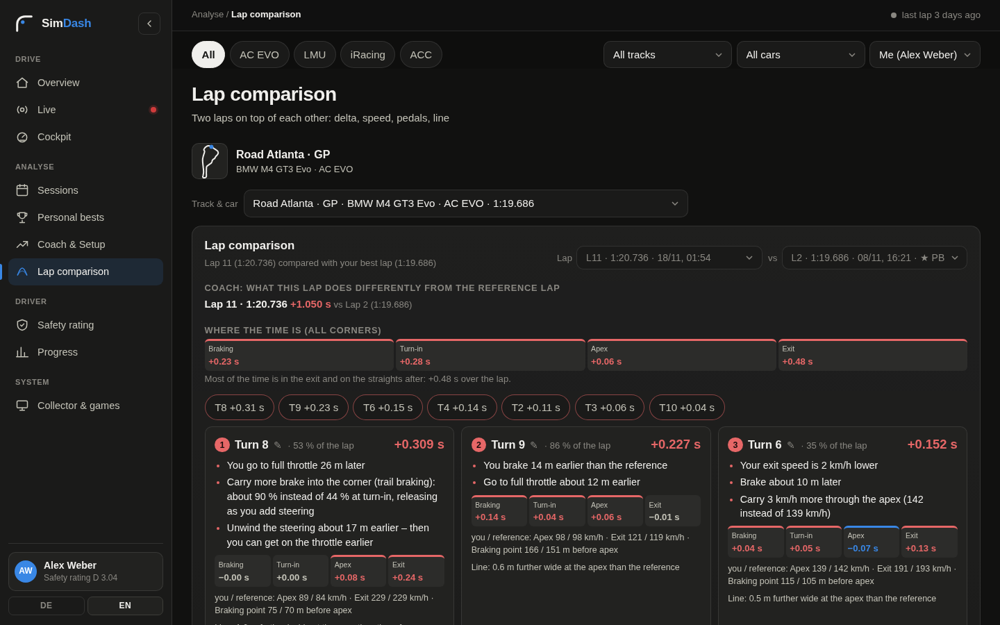
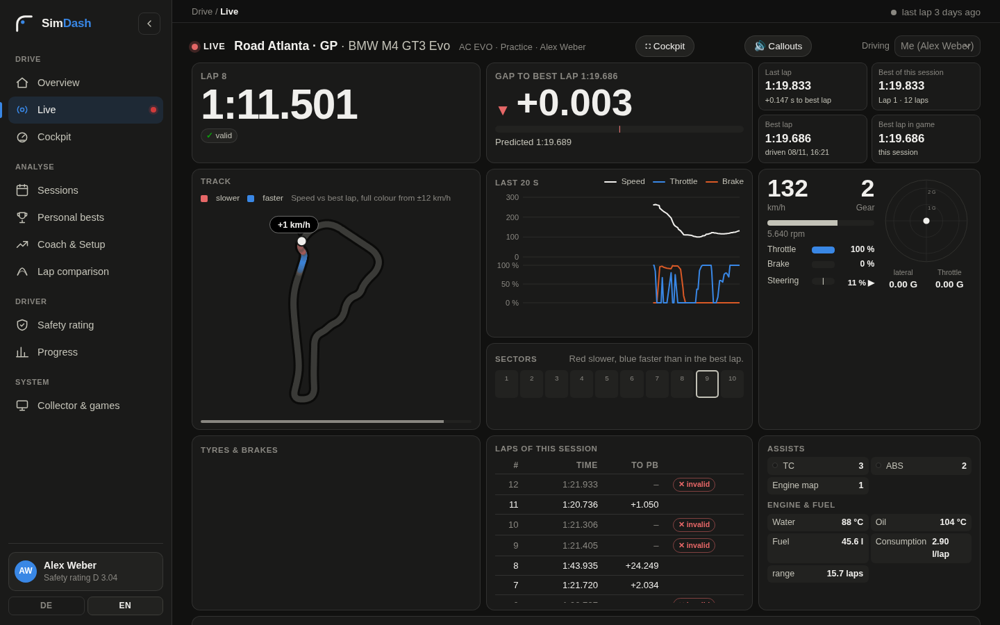
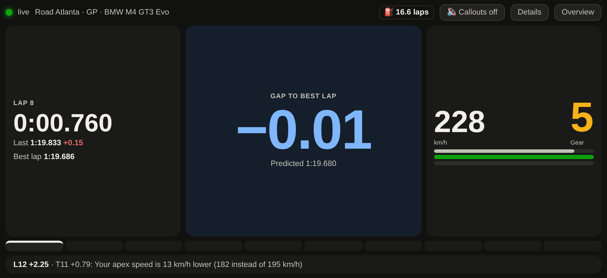

# User guide

The web UI is available in English and German. It starts in your browser's
language; **DE | EN** at the bottom of the menu switches it (saved per device,
`?lang=en` in the address works too). This guide uses the English labels and
gives the German label in quotes the first time it appears.

The menu on the left has the groups **Drive** (overview, live, cockpit),
**Analyse** (sessions, personal bests, coach & setup, lap comparison),
**Driver** (safety rating, progress) and **System** (collector & games). On a
phone it opens with ☰. The filter bar (game, track, car, driver) applies to the
overview and the analysis pages.

## Overview ("Übersicht")

- **Newest PB** ("Neueste Bestzeit"): the most recent personal best and the PBs
  before it. Next to it are the key figures: laps, tracks, cars and driving time.
- **Session report** ("Bericht zur letzten Session"):
  - best lap (★ if it is a new PB), valid and clean laps, consistency (±
    standard deviation of the clean laps)
  - change in median and best lap compared with the previous session with the
    same car and track
  - ideal lap of this session, the biggest time gain with a tip, the least
    consistent corner, and the latest setup note
  - every session in the list has a **"Bericht"** button that shows its report
    here
- **Bests** ("Bestzeiten"): one card per track and car, with a sparkline of the
  valid laps and the coach's **potential** (e.g. *−0.78 s Potenzial · v. a.
  Kurve 3*). Tap a card to open it in the analysis.
- **Recent sessions** ("Letzte Sessions"): collapsible, the newest one is open.
  Badges mark ★ PB, ✕ invalid, ≈ estimated, out lap, in lap and other drivers.

### Drivers

Did a friend drive? Use **✎** on a session to assign the whole session, or
single laps, to another name.

- Laps of other drivers don't count toward *your* bests. The driver filter at
  the top defaults to **"Ich"** (me). You can switch it to another driver or to
  all drivers.
- If a game reports you under another name, such as a nickname, those laps count
  as another driver. In the **✎** dialog, assign them to yourself and tick
  **"künftig immer so zuordnen"**. All laps with that name, past and future, then
  count for you.
- In the live tab, **"Es fährt"** sets who is driving right now. All new laps
  go to that driver until you switch back, or until 3 hours pass without a lap.

## Analysis ("Analyse")

Choose the track and car at the top. The chips jump to the sections.

### Coach ("Wo steckt noch Zeit drin?")

- **Tiles**:
  - PB
  - ideal lap ("Ideale Runde"): your best run through every corner, added up
  - potential: PB minus ideal lap
  - consistency: median of the clean laps above the PB, and how many laps are
    within 0.5 s of it
- **Top 3 corners**, ranked by time to gain. Each card shows:
  - one or two concrete tips
  - a bar that splits the loss into *braking & turn-in* (up to the apex) and
    *exit* (after the apex, including the following straight)
  - apex speed and braking point, PB lap → best run
  - the lap that was best in this corner. **"Im Vergleich ansehen"** opens the
    lap comparison with exactly those two laps and puts the crosshair on the
    corner
- **Note** on the corner with the largest lap-to-lap spread. A fixed braking
  reference helps there.
- **Map and table of all corners**:
  - red means time to gain, grey means already optimal
  - tap a number or a row to select a corner
  - the table shows potential, spread, apex speed, gear, braking point (metres before
    the apex) and full throttle (metres after the apex), each as PB → best run
- **Corner history** ("Verlauf Kurve N: wirkt der Tipp?"): the selected
  corner's time and braking point for each lap, with a line for your best run.
  The text above compares your last 5 clean laps with your best and with the
  laps before them.

How the numbers are calculated: [coach.md](coach.md).

### Progress and notes ("Fortschritt", "Setup & Notizen")

- **Progress**: best lap and median of the clean laps for each session. Up
  means faster. The text compares the last session with the one before it and
  with the first one.
- **Notes**: free text per track and car, e.g. *"brake bias 57 % more stable,
  TC 3"*. The newest note also appears in the session report.

### Lap comparison ("Rundenvergleich")

Pick a lap and a reference lap. By default these are the newest valid lap and
the fastest other lap.

- **Track map**, with three modes:
  - *Tempo-Differenz*: speed difference in km/h, red = slower. The three
    biggest losses are labelled.
  - *Zeitverlust*: where time is lost or gained.
  - *Tempo*: speed.

  Hovering the map moves the crosshair on all charts.
- **Delta over the lap**, **10 mini sectors**, **speed overlay**.
- **Gear** ("Gang") and **steering** ("Lenkung"), for laps recorded with collector
  0.6 or newer. Up means steering right.

### Lap times ("Rundenzeiten")

All laps of this car and track in order, with a PB line and an optional table.

## Live

Open the tab on a second screen or your phone while driving. The phone screen
stays on.

- **Current lap** with validity. **Delta to your PB** with a bar and the
  predicted lap time ("Prognose"). **Tiles**: last lap, best of the session,
  PB, best lap the game reports.
- **Track** with your position. The trail is coloured by the speed difference
  to your PB at the same point.
- **Last 20 s**: speed, throttle and brake.
- **Sectors**: the 10 mini-sector deltas of the current lap.
- **Inputs**: speed, gear, rpm, pedals, steering, G-forces.
- **Tyres & brakes**: pressure, core, inner, middle and outer temperatures, brake
  temperature, locking.
- **Assists** ("Fahrhilfen"): TC, ABS, brake bias, engine map. TC and ABS
  activity stays lit briefly so it doesn't flicker.
- **Engine & fuel** ("Motor & Sprit"): water, oil, power, torque, fuel, fuel per
  lap, range in laps.
- **Laps of this session**.

Which values appear depends on the game. See the table in the
[README](../README.md#supported-games).

## Cockpit (phone at the rig)

Open the live tab and tap **⛶ Cockpit** (or go to `/#cockpit`). Tap once to
start: Android goes full screen and locks landscape; the screen stays on while
the cockpit is open. On iPhone, Safari cannot hide its bars from a web page –
use *Share → Add to Home Screen* while the cockpit is open and start SimDash
from the home screen icon. ✕ leaves the cockpit. If the connection drops, the
dot turns red and the cockpit reconnects by itself.
